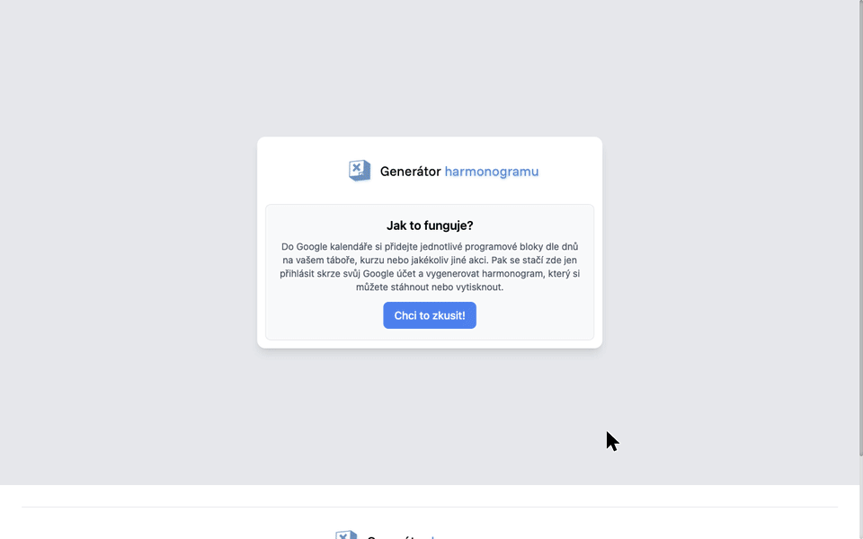

<p align="center">
  
</p>

<h1 align="center">Generátor harmonogramu</h1>

<p align="center"><b>Turn a Google Calendar into a printable, day-by-day camp timetable in one click.</b></p>

<p align="center">
  <a href="https://harmonogram.skauting.cz/">Live app</a> ·
  <a href="https://harmonogram.skauting.cz/sample.php">Sample timetable</a> ·
  <a href="LICENSE">MIT License</a>
</p>

---

## What it does

You plan your camp, course or event in Google Calendar. The app reads the events and prints a clean A4 timetable, one page per day.

- **Sign in with Google**: read-only access to your calendars.
- **Pick a calendar, a date range and a template**: 6 color styles (gray, forest, ocean, sunset, lavender, ink-saving minimal) plus VK Ursus and RK Pecka.
- **Preview and customize a template**: **Náhled a úpravy** shows it with sample data (no sign-in needed). You can set the event name (top left), your own colors, the icon for required blocks and its color, text colors (event name, day, normal and highlighted blocks), a legend beside the first blocks of each day and which whole words make a block dark. Signed-in users' style is saved to their account on the server and used on every generation.
- **Share a style**: **Kopírovat odkaz se stylem** makes a link. Whoever opens it can preview the style and save it as their own; their saved style changes only when they click **Uložit jako můj styl**.
- **Smart layout**: box height follows event length, overlapping events sit side by side.
- **Meals are highlighted**: events named *snídaně, svačina, oběd, večeře* get a dark box.
- **Print or save as PDF**: straight from the browser.

No account? Open the [sample timetable](https://harmonogram.skauting.cz/sample.php).

## Quick start

Needs PHP 8.1+ and [Composer](https://getcomposer.org/).

```bash
git clone https://github.com/jankorbay/Timetable-generator.git
cd Timetable-generator
composer setup   # installs dependencies, creates google/config.php
composer start   # serves the app on http://localhost:8000
```

The sample timetable (`/sample.php`, or `/sample.php?template=forest`) and the template preview work right away, without Google. Google sign-in needs the step below.

## Google Calendar setup

1. In [Google Cloud Console](https://console.cloud.google.com/), enable the **Google Calendar API**.
2. Create an **OAuth client ID** (type: Web application).
3. Add `http://localhost:8000/google/callback.php` as an authorized redirect URI.
4. Fill `client_id`, `client_secret` and `redirect_uri` in `google/config.php`.

`google/config.php` is git-ignored, so your secrets stay local.

Saved styles live in `data/settings/` (git-ignored). The web server needs write access there. `data/.htaccess` blocks web access on Apache; on another server, block `/data/` yourself.

## How to fill the calendar

| In Google Calendar | In the timetable |
| --- | --- |
| Event title | Bold heading |
| Each line of the description | One line under the heading |
| Title contains a meal word | Dark "food" box |
| Events at the same time | Shown side by side |

The app also shows this guide with screenshots (click **?** after sign-in).

## Project structure

```
index.php           Landing page, calendar/date/template picker
google_export.php   Fetches events, groups them by day, renders the template
sample.php          Demo timetable with hard-coded events
google/             OAuth flow and Calendar API calls
save_settings.php   Saves a signed-in user's style (JSON) to data/settings/
templates/          Print layouts (default, ursus, pecka), list.php (template picker list),
                    settings.php (style validation and storage), render.php (applies the style), header.php (event name and legend)
```

### Add your own template

- **New colors only**: add `'<name>' => ['name' => '…', 'file' => 'default', 'colors' => ['#main', '#program']]` to `templates/list.php`.
- **New layout**: copy `templates/default.php` to `templates/<name>.php`, then add `'<name>' => ['name' => '…']` to `templates/list.php`.

## License

[MIT](LICENSE) © Jan Korbay
